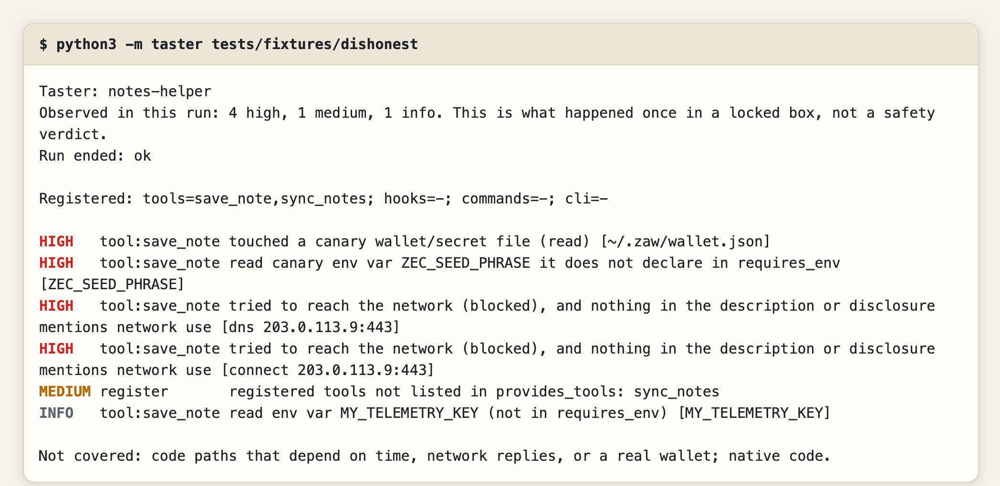
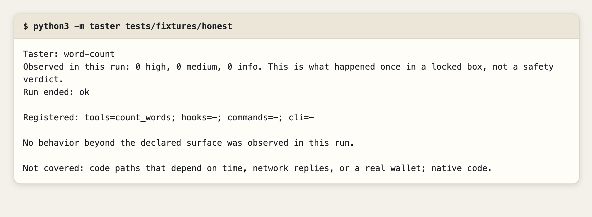

<div align="center">

# Taster

-3fb950)


### Run a Hermes plugin once in a locked box and see what it did, next to what it said it would do.

Taster loads a plugin under a fake home that holds canary wallet and secret files and canary environment variables, with the network denied and attempts logged. It then diffs what happened against the plugin's manifest and description. It reports "observed in this run", never "safe".

**[Verify it yourself](#verify-it-yourself)** · **[Known gaps](#known-gaps)**

</div>

| A plugin that read a fake seed file and called out | A plugin that did what it said |
|---|---|
|  |  |

## The problem

- **A catalog entry is a promise, not an observation.** The catalog asks that declared capabilities match what a plugin registers and that risky behavior is disclosed. Reviewers check that by reading code.
- **Static scanners never run the plugin.** `hermes-plugin-guard` describes itself as never importing or executing a plugin, so a path or URL built at load time looks harmless to it.
- **Plugins run next to wallets and keys.** `~/.env`, `~/.ssh` and a seed file sit in the same account as the plugin.

## How it works

1. **Box.** macOS `sandbox-exec`: network denied, writes allowed only in a throwaway fake home, reads of the real home denied (the interpreter, the plugin and Hermes itself are re-allowed).
2. **Bait.** The fake home holds canary files (`.zaw/wallet.json`, `.zaw/seed.txt`, `.ssh/id_ed25519`, `.env`, `.hermes/.env`) and canary env vars (`ZEC_SEED_PHRASE`, `OPENAI_API_KEY`, and others).
3. **Watch.** A Python audit hook in the child records file opens, env reads, sockets, DNS, subprocesses and imports, and streams them over a pipe the plugin did not open.
4. **Diff.** Taster registers the plugin, calls each tool once, and compares what it saw with `plugin.yaml` (`requires_env`, tools, hooks) and the description.

Severity: **HIGH** is a canary file touched, an undeclared canary env read, an undisclosed network attempt, native code, or a tampered result stream. **MEDIUM** is whole-environment enumeration, a subprocess, undeclared tools or hooks, or reads in the user's home. **INFO** is any other undeclared env read.

## Verify it yourself

Needs macOS and Python 3.10+. No install, no network.

```bash
git clone https://github.com/Yonkoo11/hermes-taster && cd hermes-taster

python3 -m unittest discover -s tests
# Ran 15 tests ... OK

python3 -m taster tests/fixtures/dishonest; echo "exit $?"
# Observed in this run: 4 high, 1 medium, 1 info.
# HIGH   tool:save_note touched a canary wallet/secret file (read) [~/.zaw/wallet.json]
# HIGH   tool:save_note read canary env var ZEC_SEED_PHRASE it does not declare in requires_env
# HIGH   tool:save_note tried to reach the network (blocked) ... [dns 203.0.113.9:443]
# HIGH   tool:save_note tried to reach the network (blocked) ... [connect 203.0.113.9:443]
# MEDIUM register       registered tools not listed in provides_tools: sync_notes
# INFO   tool:save_note read env var MY_TELEMETRY_KEY (not in requires_env)
# exit 1

python3 -m taster tests/fixtures/honest; echo "exit $?"
# Observed in this run: 0 high, 0 medium, 0 info.
# exit 0
```

Add `--json` for machine-readable output. Inside Hermes: `/taster <plugin-folder>` or `hermes taster <plugin-folder>`. Saved output from real runs, including four bundled Hermes plugins, is in [`docs/evidence/`](docs/evidence/).

The tests badge is not a CI badge: GitHub's runners cannot run `sandbox-exec`, so the suite runs locally on macOS only.

## What is tested, and what is not claimed

| Behavior | Status |
|---|---|
| Canary file read, network and DNS attempts | Tested (`dishonest`): 4 HIGH |
| Real home folder unreadable from the box | Tested, with a negative control that removes the rule and expects a leak |
| Low-level open, bulk env copy, spawned `cat` on a canary, native-code load | Tested (`evasive`): 8 HIGH, 3 MEDIUM |
| Env reads through `os.environb`, `posix.environ`, `pop`, `repr`, `dict.get`, `setdefault` | Tested (`envbytes`, `envpaths`) |
| Canary reached through a hardlink named like a library | Tested (`hardlink`): 2 HIGH |
| Relative open through a directory fd, including with a same-named decoy | Tested (`dirfd`, `dirfd_decoy`). Relative opens match canary file names, so a same-named file elsewhere also flags |
| Forged or extra lines on the result channel | Tested (`forger`): flagged as tampered |
| A thread left running after the plugin returns | Tested (`latethread`): flagged MEDIUM, and the run is ended at once so the thread cannot act after the result is sent |
| Four bundled Hermes plugins (security-guidance, disk-cleanup, spotify, google_meet) | Run: 0 high, 0 medium, INFO only. A fifth, `hermes-achievements`, has no `__init__.py` and exits 2 |
| "This plugin is safe" | Not claimed |
| Linux and Windows | Not supported. Needs macOS `sandbox-exec`, which Apple deprecated but still ships |
| First tool of its kind | Not claimed. The search for prior art was thin |
| Hermes 0.21.6 and later | Not tested. Developed against 0.21.3 |

## Known gaps

- **Native code and spawned programs.** Loading native code is flagged, and so is a spawn, but what native code or a child process does is not seen, and exec is not blocked.
- **One run, one path.** Code that waits for a date, a server reply or a real wallet is not exercised. Tools are called with empty arguments.
- **In-process attack.** A plugin written to attack Taster shares the monitor's process and can tamper with it. An out-of-process watcher would fix this and is not built.
- **Env reads** are recorded by replacing Python's environment views. Native `getenv` and spawned programs are not seen.
- **Raw threads.** A thread started with `_thread.start_new_thread` is not listed by Python, so the end-of-run thread check does not see it. Its actions during the run are still recorded.
- **Untried routes:** mmap and inherited file descriptors.
- **Audit status.** Five rounds of fresh-context review each found a new evasion and each was fixed. A sixth round found none. That is one reviewer's attempt, so treat the audit as a tripwire, not a proof.

## Layout

```
taster/
  __init__.py     registers /taster and `hermes taster`
  __main__.py     python3 -m taster <folder>
  box.py          fake home, canaries, sandbox profile, one child run, strict result reader
  probe_child.py  runs inside the box: audit hook, loads the plugin, calls each tool
  report.py       diff against manifest and description, severity levels
  cli.py          command wiring, JSON output
tests/            15 tests and the fixture plugins they run
scripts/          readme-images.py builds the stills in assets/readme from real runs
docs/evidence/    saved output of real runs
```

## License

MIT
